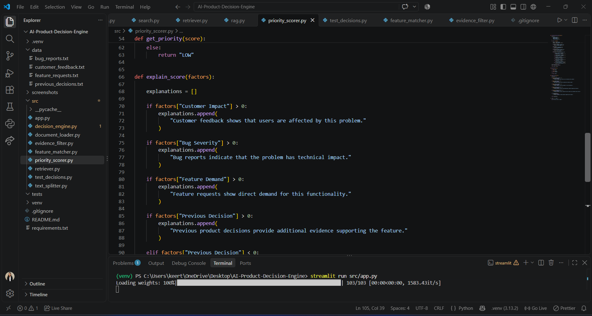
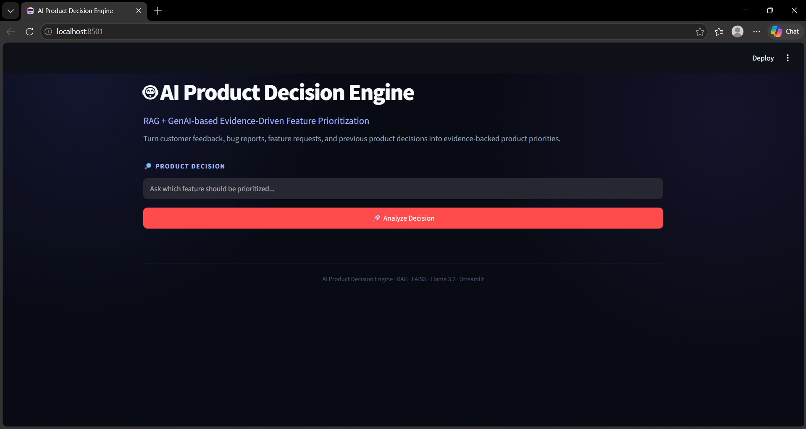
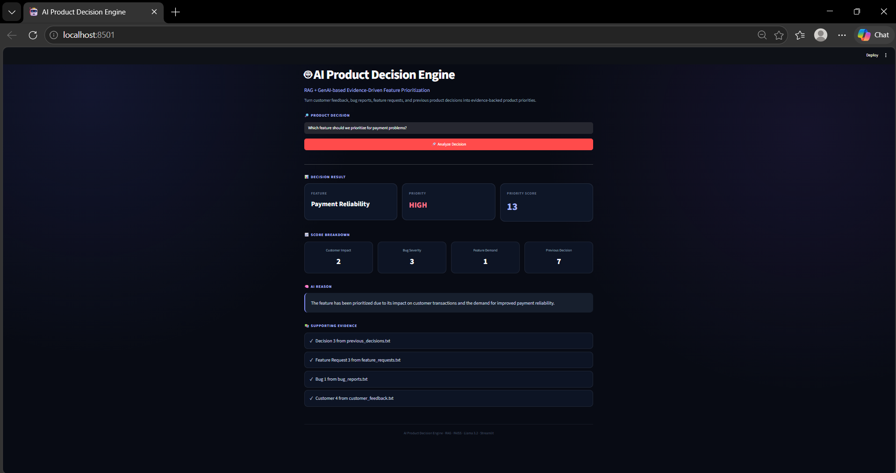
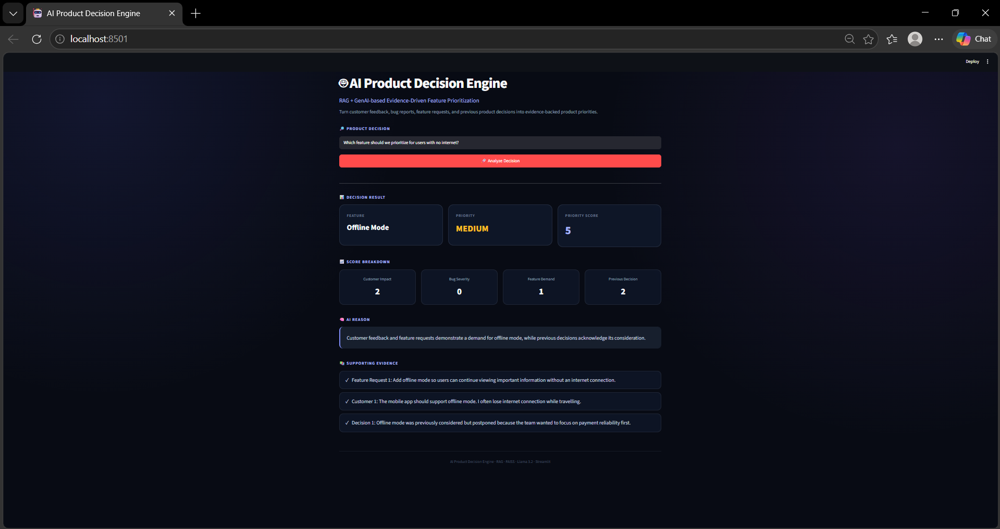

# AI Product Decision Engine

### RAG + GenAI-Based Evidence-Driven Feature Prioritization

An AI-powered decision support system that helps product teams prioritize features using customer feedback, bug reports, feature requests, and previous product decisions.

The system retrieves relevant evidence using Retrieval-Augmented Generation (RAG), calculates a priority score using rule-based logic, and uses a local Large Language Model (LLM) to generate an explanation supported by the retrieved evidence.

---

## Application Screenshots

### 1. Project Structure in Visual Studio Code

The project structure illustrates how the application is organized into separate modules for document loading, evidence retrieval, feature matching, priority scoring, and the user interface.




### 2. Main Dashboard

The main dashboard provides a simple interface for users to enter product-related questions and analyze feature priorities. It serves as the starting point for evidence-based product decision-making.



### 3. Payment Reliability Analysis

This screenshot demonstrates how the system analyzes payment-related problems and presents a priority score, score breakdown, AI-generated explanation, and supporting evidence.



### 4. Offline Mode Analysis

This screenshot shows how the system evaluates an offline-mode request by retrieving relevant evidence from customer feedback, bug reports, feature requests, and previous decisions.



---

## Problem Statement

Product teams receive customer feedback, bug reports, feature requests, and previous product decisions from different sources. Determining which feature deserves attention can be difficult when the evidence is scattered across documents.

A decision based only on opinions or an LLM-generated response may not provide a clear explanation for why a feature was selected.

This project addresses the problem by combining document retrieval, structured priority scoring, and evidence-based AI explanations.

## Proposed Solution

The AI Product Decision Engine processes product information and provides a structured feature-prioritization result.

The system:

- Retrieves relevant information from product documents.
- Identifies the product feature associated with a question.
- Filters evidence relevant to that feature.
- Calculates a priority score using predefined rules.
- Uses Llama 3.2 to explain the decision.
- Displays the priority, score breakdown, explanation, and supporting evidence through a Streamlit dashboard.

## System Architecture

```text
Customer Feedback
Bug Reports
Feature Requests
Previous Decisions
        |
        v
Document Loading
        |
        v
Text Splitting
        |
        v
Sentence Embeddings
        |
        v
FAISS Vector Search
        |
        v
Relevant Evidence Retrieval
        |
        v
Feature Identification
        |
        v
Evidence Filtering
        |
        v
Rule-Based Priority Scoring
        |
        v
Llama 3.2 Explanation
        |
        v
Streamlit Dashboard
```

## How It Works

### 1. Document Loading

The system reads text documents containing customer feedback, bug reports, feature requests, and previous product decisions.

### 2. Text Splitting

Documents are divided into smaller chunks so that relevant information can be retrieved more precisely.

### 3. Embedding Generation

The `all-MiniLM-L6-v2` Sentence Transformers model converts text into numerical vector representations.

### 4. Semantic Retrieval

FAISS searches the stored embeddings to identify text chunks relevant to the user's question.

### 5. Feature Identification

The feature matcher identifies the product feature associated with the query.

### 6. Evidence Filtering

The evidence filter selects retrieved chunks that match the identified feature.

### 7. Priority Scoring

The priority scorer calculates a score using four factors:

| Factor | Purpose |
|---|---|
| Customer Impact | Considers customer feedback |
| Bug Severity | Considers technical issues |
| Feature Demand | Considers feature requests |
| Previous Decision | Considers earlier product decisions |

### 8. AI-Generated Explanation

Llama 3.2 generates a natural-language explanation using the calculated priority and supplied evidence.

The LLM is instructed to explain the existing decision rather than change the calculated priority.

### 9. Interactive Dashboard

Streamlit presents the result, including the feature name, priority, score, score breakdown, AI explanation, and supporting evidence.

## Technology Stack

| Technology | Purpose |
|---|---|
| Python | Core application logic |
| LangChain | LLM integration |
| Ollama | Runs the local LLM |
| Llama 3.2 | Generates decision explanations |
| Sentence Transformers | Generates text embeddings |
| FAISS | Vector similarity search |
| NumPy | Numerical array operations |
| Streamlit | Interactive web interface |

## Project Structure

```text
AI-Product-Decision-Engine/
├── data/
│   ├── customer_feedback.txt
│   ├── bug_reports.txt
│   ├── feature_requests.txt
│   └── previous_decisions.txt
├── screenshots/
│   ├── main-dashboard.png
│   ├── payment-reliability.png
│   ├── offline-mode.png
│   └── project-structure.png
├── src/
│   ├── app.py
│   ├── decision_engine.py
│   ├── document_loader.py
│   ├── evidence_filter.py
│   ├── feature_matcher.py
│   ├── priority_scorer.py
│   ├── retriever.py
│   ├── test_decisions.py
│   └── text_splitter.py
├── tests/
├── .gitignore
├── README.md
└── requirements.txt
```

## Installation and Setup

### Prerequisites

- Python 3.11
- Git
- Ollama
- The `llama3.2:3b` model

### 1. Clone the Repository

```bash
git clone YOUR_GITHUB_REPOSITORY_URL
cd AI-Product-Decision-Engine
```

Replace `YOUR_GITHUB_REPOSITORY_URL` with the actual URL of your GitHub repository.

### 2. Create a Virtual Environment

```powershell
python -m venv venv
.\venv\Scripts\Activate.ps1
```

### 3. Install Dependencies

```powershell
pip install -r requirements.txt
```

### 4. Download the Local LLM

Install Ollama if it is not already installed, then run:

```powershell
ollama pull llama3.2:3b
```

### 5. Run the Application

From the project root directory:

```powershell
streamlit run src/app.py
```

Open the local URL displayed in the terminal, usually:

`http://localhost:8501`

## Example Questions

Try the following questions in the dashboard:

- Which feature should we prioritize for payment problems?
- Which feature should we prioritize for users with no internet?
- Should we prioritize dark mode?
- Which feature should we prioritize for report downloads?
- Which feature should we prioritize for slow mobile loading?
- Should we prioritize low battery mode?

## Key Highlights

- Combines RAG with rule-based decision scoring.
- Uses semantic retrieval to find relevant product evidence.
- Separates priority calculation from LLM-generated explanations.
- Displays supporting evidence to improve transparency.
- Uses a local LLM through Ollama.
- Provides an interactive dashboard for product decision analysis.


## Limitations

- Priority scores depend on the current scoring rules.
- Results depend on the quality and relevance of available documents.
- Keyword-based feature matching may not recognize every possible phrasing.
- LLM-generated explanations may contain inaccuracies and should be checked against the evidence.
- The project is a decision-support prototype, not a replacement for product-team judgment.

## Future Enhancements

- Contradiction detection across product documents.
- What-if analysis for different scoring scenarios.
- Improved feature matching and evidence retrieval.
- Retrieval-quality and decision-consistency evaluation.
- Support for additional document formats.
- Configurable scoring weights for different product teams.

## Author

**Keerthana Dhandapani**

- GitHub: [Dhandapanikeerthana](https://github.com/Dhandapanikeerthana/AI-Product-Decision-Engine.git)
- LinkedIn: [Keerthana D.](https://www.linkedin.com/in/keerthana-d-07839531a/)

---

*Built with Python, RAG, FAISS, Sentence Transformers, Ollama, Llama 3.2, and Streamlit.*
